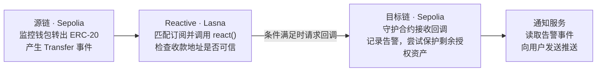

# D1 用例拆解：事件驱动的钱包异常告警与自动保护

## 用例概述

项目定位为**事件驱动的钱包异常告警，并演示对预授权测试资产的自动保护**。

用户配置受监控的钱包、ERC-20 测试代币、可信地址和安全地址。当指定代币转往未加入可信名单的地址时，系统记录告警并向用户推送，同时尝试将测试金库中由用户预先授权保护的资产转往安全地址。

第一版使用 Sepolia 和 Lasna 测试网，具体 ERC-20 测试代币合约地址待选定。本页描述待实现的方案。

## 流程图

## 1. 监听哪条链、哪个合约的什么事件？

在 Ethereum Sepolia 上，监听用户预先指定的 ERC-20 测试代币合约的 `Transfer(address indexed from, address indexed to, uint256 value)` 事件，筛选 `from` 为受监控钱包的事件。Reactive 合约部署在 Lasna。

第一版覆盖指定 ERC-20 的转账事件，原生 ETH 转账需要额外的监控方案。每种代币的实现和事件行为也需要分别核实。

## 2. 满足什么条件时触发？

当受监控钱包向不在用户可信名单中的地址转出指定 ERC-20 测试代币时，触发告警，并请求执行测试金库的授权资产转移。

可信名单由用户配置。“陌生地址”在本方案中指不在该名单中的地址，不代表已被判定为恶意地址。合约地址和普通地址都需要按照明确的名单规则处理。用户配置如何同步到 Reactive 侧，留待实现时设计。

## 3. 在哪条链做什么动作？

Reactive 在 Lasna 判断事件后，请求 Sepolia 上的守护合约记录告警事件。通知服务监听告警并向用户发送推送。

守护合约尝试把测试金库中仍有余额、且用户预先授权保护的测试资产转往指定安全地址。告警与转移结果需要分别记录，便于识别转移失败。若资产已在触发事件的同一笔交易中全部转走，后续回调无法追回。

## 4. 不用 Reactive 时怎么做？它简化了什么，代价是什么？

不用 Reactive 时，需要自行运行链下机器人，持续监听 `Transfer` 事件、判断规则、发送通知，并在有权限时向守护合约发起交易。用户也可以手动查看交易。

使用 Reactive 后，事件订阅、条件判断和回调请求可以写进 Reactive Contract，无须自行维护负责触发合约动作的监听机器人。推送通知仍需要消息投递组件。

代价包括 Reactive 执行和目标链回调费用、合约与授权维护，以及处理欠款、回调失败和跨链延迟。响应发生在事件上链之后，自动转移不能保证赶在攻击者的下一笔交易之前。

## 测试网验收目标

1. 向可信地址转账时，不触发陌生地址告警或保护转移。
2. 向陌生地址转账后，能关联源链 `Transfer`、Lasna 执行和 Sepolia 告警交易，并收到推送。
3. 测试金库具备预先配置的权限和余额时，能核验资产转往安全地址；转移失败时能查看失败结果。

这些目标需要在实现后通过测试验证。

## 参考资料

- [Reactive Contracts：订阅、事件处理与回调](https://dev.reactive.network/reactive-contracts)
- [Callback Contracts：回调身份校验](https://dev.reactive.network/callback-contracts)
- [Economy：费用与欠款](https://dev.reactive.network/economy)
